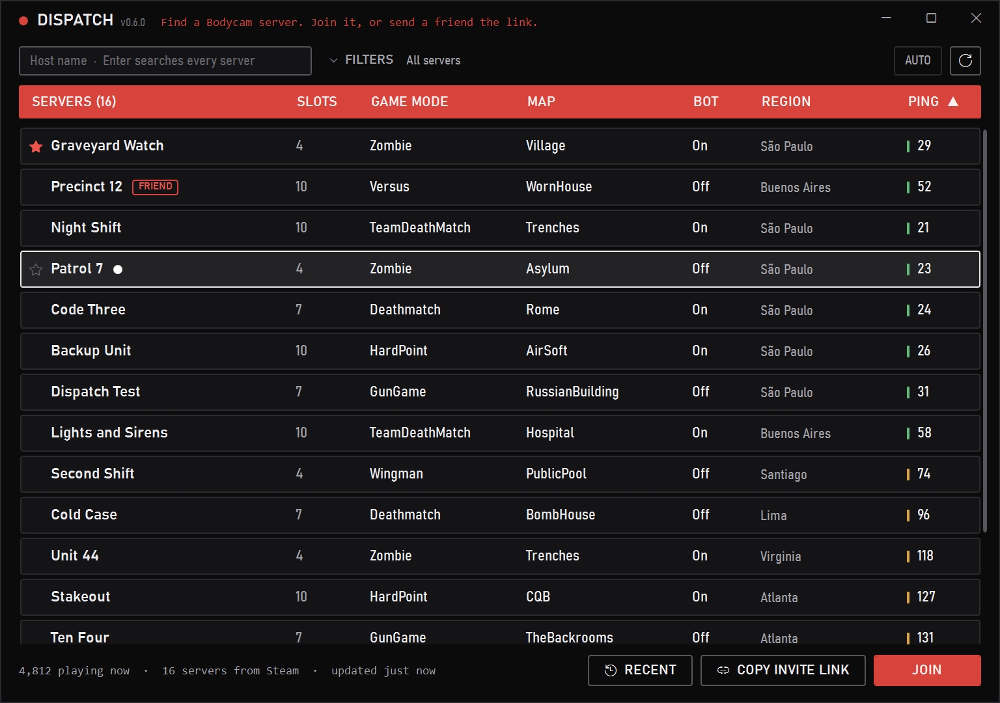

# Dispatch

**Find a Bodycam server, join it, or send a friend the link.**

   

 

One small portable file · <a href="https://github.com/skye-cp/dispatch/releases">All releases</a>

 
 

 

Bodycam's party system is offline, so friends can't queue together, and the in-game server list has no search, filters or ping. Dispatch reads the same public server list from Steam, lets you sort and filter it, and puts you or your friends into a chosen server through Steam's own join link.

## Features

- **Every server.** About 300 at once, against the 50 a single Steam search returns, each with its ping, age and slots, and a mark when a new round starts.
- **Filters.** Mode, map, region, age, ping and bots, combined and remembered. Click a value in the list to filter by it.
- **Friends and followed hosts.** Your friends' servers are pinned to the top. Star a host to pin theirs too, and get an alert when it appears.
- **Join or invite in one click.** Join a server, copy its invite link for friends, find a host by name, or rejoin one from **Recent**.
- **Auto-refresh.** Every minute while Dispatch is open, with new servers marked.

## Requirements

- Windows 10 or 11
- Steam, running and signed in
- Bodycam, installed

## Quick start

1. [Download `Dispatch.exe`](https://github.com/skye-cp/dispatch/releases/latest/download/Dispatch.exe) and run it. Nothing to install.
2. Start Bodycam and wait at the main menu.
3. Pick a server and press **Join**.

> [!NOTE]
> Releases are not code-signed yet, so Windows may warn about an unknown publisher on the first run. Choose **More info**, then **Run anyway**.

Keyboard shortcuts are listed in the menu (<kbd>F1</kbd>).

### Play with a friend

- **Bring them to your server.** Select it and press **Copy invite link** (joining copies it too). Your friend pastes the link into Dispatch's search box, or into <kbd>Win</kbd>+<kbd>R</kbd>, with Bodycam running.
- **Go to theirs.** A friend's server is already at the top, marked **FRIEND**. Otherwise type the host's name, as shown in the game's server list, and press <kbd>Enter</kbd>.
- **Wait for them.** Star their host name. While Dispatch is open, you get a sound and a flashing taskbar button when their server appears.

## FAQ

<b>Is it safe to use with Easy Anti-Cheat?</b>

 

Dispatch never touches the game's memory or network traffic, injects nothing and sends no input to the game. It talks only to Steam, the way Steam's own invites do, from a separate short-lived process, and only reads the game's files.

<b>Is it allowed?</b>

 

Dispatch is unofficial and gives no gameplay advantage: it shows the same public server list the game uses. However, Bodycam's terms prohibit "unauthorized programs" in connection with the game's online features, and Steam's terms restrict unauthorized third-party software, without defining either. Enforcement is at their discretion, so **use Dispatch at your own risk**. If Reissad Studio or Valve asks for it to be taken down, it will be.

<b>Why are there no player counts?</b>

 

Steam doesn't publish them for Bodycam servers: players connect to the host without joining its Steam lobby. <i>Slots</i> is the server's size. If a server is full, the game says the connection failed and returns to the menu.

<b>How are age and ping worked out?</b>

 

Age comes from Steam's lobby numbers, which rise steadily across all games, so it is accurate to within a few minutes. Ping is Steam's estimate of the round trip through its relay network: close, though the game may route differently.

<b>A join didn't work.</b>

 

Join from Bodycam's main menu: opening a link while the game is closed has failed in testing, so Dispatch asks first. Wingman matches can't be joined once they have started.

<b>Why does Steam show me in Bodycam for a moment?</b>

 

Each lookup briefly runs as Bodycam's Steam app (about a second) to read the server list, which Steam counts as Bodycam playtime. Auto-refresh and followed hosts repeat that once a minute while Dispatch is open. Lookups pause for two minutes after you join a server.

## Privacy

- **Reads** only public server data from Steam, and your Steam friends list to mark their servers. The friends list stays in memory, never saved or sent.
- **Saves** your filters, preferences, followed hosts, recent servers, window position and reference points for age and ping in `%APPDATA%\Dispatch\settings.ini`, and a copy of Steam's library and any error log in `%LOCALAPPDATA%\Dispatch`.
- **Asks** Steam for the total number of Bodycam players, and GitHub for the latest release at most every 12 hours. Neither carries personal data. To stop the update check, add `updateCheck=0` to `settings.ini`.
- **To remove Dispatch,** delete `Dispatch.exe` and those two folders.

## Contributing

Issues and pull requests are welcome. See [CONTRIBUTING.md](CONTRIBUTING.md) to build, test and learn how Dispatch works.

## License

[MIT](LICENSE). Dispatch is a fan-made tool, not affiliated with or endorsed by Reissad Studio or Valve. Bodycam and Steam are trademarks of their owners.
